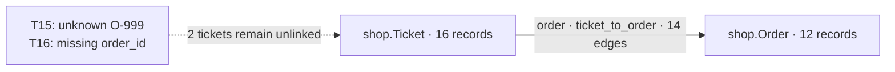

# Quickstart: from two files to an explained result

Import orders, import support tickets, connect them, compare delivery complaints,
and open the records behind one aggregate. Then add a field and correct a value
without rebuilding the memory. Each step below gives an action and its result.
All data is synthetic and no API key is needed.

## 0. Open the bundle and create a demo memory

Follow [download and unpack](plugin-installation.md#download-and-unpack), then
open `PAYLOAD_ROOT`. The archive includes the application **and** the fixtures;
you do not clone GitHub or build from source. The commands use a macOS/Linux
shell and stay in this directory for the whole walkthrough.

```console
cd "${PAYLOAD_ROOT:?set PAYLOAD_ROOT to the absolute unpacked payload path}"
uv sync --frozen --no-dev --python 3.12
DEMO_ROOT="$HOME/analytical-memory-demo"
mkdir -p "$DEMO_ROOT"
uv run --frozen --no-dev memory --backend sqlite memories configure create retail-demo \
  --backend sqlite --database "$DEMO_ROOT/memory.db" \
  --evidence-root "$DEMO_ROOT/evidence"
```

Expected response, with paths abbreviated:

```json
{"action":"create","memory":"retail-demo","target":{"backend":"sqlite","database":"…/memory.db","evidence_root":"…/evidence"}}
```

Use a new name and data directory if `retail-demo` already exists. Do not wipe an
existing memory to repeat the example. The catalog uses the same per-user default
as the plugin. If you override `ANALYTICAL_MEMORY_PLUGIN_DATA`, set
`ANALYTICAL_MEMORY_DATA_ROOT` to the same directory for CLI use, or give both
routes the same `ANALYTICAL_MEMORY_CATALOG`. The explicit `--backend sqlite`
keeps this demo usable when shared configuration selects PostgreSQL.
Define a short command that always selects this memory, and read its contract:

```console
memory_demo() { uv run --frozen --no-dev memory --backend sqlite --memory retail-demo "$@"; }
memory_demo schema show > "$DEMO_ROOT/contract.json"
FINGERPRINT="$(uv run --frozen --no-dev python -c 'import json,sys; print(json.load(open(sys.argv[1]))["schema_fingerprint"])' "$DEMO_ROOT/contract.json")"
memory_demo ontology describe --namespace shop
```

Expected: `document.entities` and `document.relations` are empty;
`document.statistics.nodes` is `0`.

CLI output below is excerpted: omitted fields include hashes, UUIDs, timestamps
and provenance. Tables render returned values; row order in detail may differ.
The full responses remain available in your terminal or saved JSON files.

## 1. Import orders → discover the first entity

Look at two rows in `examples/retail/orders.jsonl`:

```jsonl
{"order_id":"O-101","carrier":"FastShip","region":"North","amount_cents":10000}
{"order_id":"O-102","carrier":"FastShip","region":"North","amount_cents":10000}
```

Import the file using `order_id` as its business key:

```console
memory_demo jsonl import examples/retail/orders.jsonl \
  --entity-type shop.Order --key '[{"field":"order_id","type":"string"}]' \
  --contract-fingerprint "$FINGERPRINT"
memory_demo ontology describe --namespace shop
```

Import response excerpt:

```json
{
  "records": 12, "created_nodes": 12, "updated_nodes": 0,
  "attributes_written": 48,
  "ontology_delta": {
    "new_entities": ["shop.Order"],
    "new_fields": ["amount_cents", "carrier", "order_id", "region"],
    "resolved_types": []
  }
}
```

Queryable structure, rendered from the ontology response:

```text
Before: shop has no entities
After:  shop.Order [12 records]
          order_id: string
          carrier: string
          region: string
          amount_cents: number
        Relations: none
```

No entity declaration or table mapping was required. Every order is worth
10000 cents; equal prices will help test identity-based deduplication later.


## 2. Import tickets → a second, independent entity

The second file has 16 tickets, including repeated contacts and incomplete keys:

```jsonl
{"ticket_id":"T02","order_id":"O-104","issue_code":"late_delivery","message":"Synthetic support contact 2: late_delivery."}
{"ticket_id":"T03","order_id":"O-104","issue_code":"late_delivery","message":"Synthetic support contact 3: late_delivery."}
{"ticket_id":"T15","order_id":"O-999","issue_code":"late_delivery","message":"Synthetic support contact 15: late_delivery."}
{"ticket_id":"T16","issue_code":"damaged","message":"Synthetic support contact 16: damaged."}
```

```console
memory_demo jsonl import examples/retail/tickets.jsonl \
  --entity-type shop.Ticket --key '[{"field":"ticket_id","type":"string"}]' \
  --contract-fingerprint "$FINGERPRINT"
memory_demo ontology describe --namespace shop
```

Response excerpt:

```json
{
  "records": 16, "created_nodes": 16, "updated_nodes": 0,
  "ontology_delta": {
    "new_entities": ["shop.Ticket"],
    "new_fields": ["issue_code", "message", "order_id", "ticket_id"],
    "resolved_types": []
  }
}
```

```text
shop.Order [12]                         shop.Ticket [16]
  order_id: string                       ticket_id: string
  carrier: string                        order_id: string
  region: string                         issue_code: string
  amount_cents: number                    message: string

28 nodes, 111 attributes, 0 relations
```

Matching field names do not create edges. T02–T05 all refer to O-104; T15 refers
to an unknown order and T16 has no order key.


## 3. Connect the datasets → inspect a joined answer

`examples/retail/join.json` explicitly defines the relationship:

```json
{
  "name": "ticket_to_order", "relation": "order",
  "from": {"type": "shop.Ticket", "fields": ["order_id"]},
  "to": {"type": "shop.Order", "fields": ["order_id"]}
}
```

```console
memory_demo join materialize examples/retail/join.json \
  --contract-fingerprint "$FINGERPRINT"
memory_demo ontology describe --namespace shop \
  | tee "$DEMO_ROOT/linked-ontology.json"
memory_demo query execute --document examples/retail/linked-query.json
```

Join response excerpt:

```json
{"created_relations":14,"skipped_unmatched":1,"skipped_null_or_missing":1}
```



The query follows this exact relation and keeps `late_delivery` and `damaged`.
It returns 10 rows. Here are four of their projected values, shown as a table:

| o.order_id | o.carrier | o.region | t.ticket_id | t.issue_code |
| --- | --- | --- | --- | --- |
| O-104 | FastShip | South | T02 | late_delivery |
| O-104 | FastShip | South | T03 | late_delivery |
| O-110 | EcoPost | South | T08 | late_delivery |
| O-111 | EcoPost | South | T09 | damaged |

Each projection also carries source, fragment, run and batch identifiers.
The repeated O-104 rows are real contacts, not duplicate orders to count again.
The two unlinked tickets are absent from this connected query; the next step
measures their coverage explicitly.


## 4. Aggregate → compare contacts with affected orders

Run the native query and save its full response:

```console
memory_demo query execute --document examples/retail/query.json \
  | tee "$DEMO_ROOT/aggregate.json"
```

The query starts with **all orders**, optionally matches delivery tickets, groups
by carrier/region, counts distinct identities, sums affected order values once
per order, and derives the affected-orders/orders ratio. No client calculation
is needed. The four returned groups are:

| Carrier | Region | Orders | Delivery contacts | Affected orders | Rate | Affected value, cents |
| --- | --- | ---: | ---: | ---: | --- | ---: |
| EcoPost | South | 3 | 3 | 3 | 3/3 | 30000 |
| EcoPost | North | 3 | 2 | 2 | 2/3 | 20000 |
| FastShip | North | 3 | 1 | 1 | 1/3 | 10000 |
| FastShip | South | 3 | 4 | 1 | 1/3 | 10000 |

Within `result.groups`, the first group's excerpt is:

```json
{
  "key": {
    "carrier": {"kind":"value","type":"string","value":"EcoPost"},
    "region": {"kind":"value","type":"string","value":"South"}
  },
  "measures": {"orders":3,"delivery_tickets":3,"affected_orders":3,"affected_order_value":30000},
  "derived": {"complaint_rate":{"numerator":3,"denominator":3,"decimal":"1.000000000000"}}
}
```

Now run the packaged analysis document. It executes carrier/region, carrier,
grand total, ticket inventory, delivery coverage and join inspection together
in one consistent snapshot:

```console
memory_demo query analysis-execute --document examples/retail/analysis.json \
  | tee "$DEMO_ROOT/analysis.json"
```

Returned `result.coverage`:

```json
{"imported_tickets":16,"delivery_tickets":12,"attributed":10,"unattributed":2}
```

| Carrier | Delivery contacts | Affected orders | All orders | Exact rate |
| --- | ---: | ---: | ---: | --- |
| EcoPost | 5 | 5 | 6 | 5/6 |
| FastShip | 5 | 2 | 6 | 2/6 |
| Grand total | 10 | 7 | 12 | 7/12 |

The carrier and total rows are separate native groups. Equal contact counts
conceal different numbers of affected orders.
FastShip South has four contacts about **one** order. Its affected value is
10000, while EcoPost South's three equally priced orders contribute 30000.
Billing-only and no-contact orders stay in the denominator.

This is association in a small synthetic sample. Affected value is the price
of affected orders, not lost revenue. Coverage reports the two delivery tickets
that could not be attributed to a known order.


## 5. Open one aggregate → get its exact members

Select the first returned group, EcoPost South. Prepare a drill request and a
capture request using the **returned state**, not a copied example UUID:

```console
uv run --frozen --no-dev python - "$DEMO_ROOT" <<'PY'
import json
import sys
from pathlib import Path

root = Path(sys.argv[1])
result = json.loads((root / "analysis.json").read_text())["result"]
query = json.loads(Path("examples/retail/query.json").read_text())
key = next(group["key"] for group in result["members"]["by_carrier_region"]["groups"]
           if group["key"]["carrier"]["value"] == "EcoPost"
           and group["key"]["region"]["value"] == "South")
requests = {
    "live-detail-request": {"query": query, "group_key": key,
                            "measure": "affected_orders", "expected_state": result["state"]},
    "capture-request": {"analysis": json.loads(Path("examples/retail/analysis.json").read_text()),
                        "expected_state": result["state"], "definition_version": "retail-delivery-1"},
}
for name, document in requests.items():
    (root / f"{name}.json").write_text(json.dumps(document, indent=2) + "\n")
PY
memory_demo query drill-down --document "$DEMO_ROOT/live-detail-request.json"
```

The Python snippet only prepares requests; the server reconstructs membership.
Returned `result.total_members` is `3`. Values from `result.rows[].attributes`:

| order_id | carrier | region | amount_cents |
| --- | --- | --- | ---: |
| O-110 | EcoPost | South | 10000 |
| O-111 | EcoPost | South | 10000 |
| O-112 | EcoPost | South | 10000 |

Each attribute includes provenance identifiers. The request specifies the
original query, exact typed group key, selected measure and generation/revision.
A changed memory causes a state-guard error instead of mixing populations;
rerun the analysis and prepare fresh requests if that happens.


## 6. Save the analysis → retain an explainable historical result

```console
memory_demo query analysis-capture --document "$DEMO_ROOT/capture-request.json" \
  | tee "$DEMO_ROOT/capture.json"
```

Response excerpt (`id` differs per memory):

```json
{"result":{"id":"<observation UUID>","definition_version":"retail-delivery-1","data_revision":3,"freshness":"current","privacy_class":"public"}}
```

The capture retains native metrics and an immutable input manifest. It does not
advance the fact revision. Prepare two requests from its actual observation ID:

```console
uv run --frozen --no-dev python - "$DEMO_ROOT" <<'PY'
import json
import sys
from pathlib import Path

root = Path(sys.argv[1])
observation = json.loads((root / "capture.json").read_text())["result"]["id"]
key = json.loads((root / "live-detail-request.json").read_text())["group_key"]
(root / "read-request.json").write_text(json.dumps({"observation_id": observation}))
(root / "saved-detail-request.json").write_text(json.dumps({
    "observation_id": observation, "query_name": "by_carrier_region",
    "group_key": key, "measure": "delivery_tickets",
}))
PY
```


## 7. Add warehouse data → extend the structure in place

`enrichment.jsonl` contains only order keys and the new field, for example:

```jsonl
{"order_id":"O-110","warehouse":"W1"}
```

```console
memory_demo jsonl import examples/retail/enrichment.jsonl \
  --entity-type shop.Order --key '[{"field":"order_id","type":"string"}]' \
  --contract-fingerprint "$FINGERPRINT"
memory_demo ontology describe --namespace shop \
  | tee "$DEMO_ROOT/enriched-ontology.json"
memory_demo query execute --document examples/retail/query.json
memory_demo query analysis-read --document "$DEMO_ROOT/read-request.json"
```

Import response excerpt:

```json
{"records":12,"created_nodes":0,"updated_nodes":12,"ontology_delta":{"new_entities":[],"new_fields":["warehouse"],"resolved_types":[]}}
```

```text
Before: Order(order_id, carrier, region, amount_cents)
After:  Order(order_id, carrier, region, amount_cents, +warehouse: string)

Ticket ──order / ticket_to_order──> Order
28 nodes remain; all 14 edges remain; existing order fields remain.
O-110, O-111, O-112 gain warehouse=W1; other orders gain warehouse=W2.
```

The aggregate still returns the same four rows. The saved observation reports (excerpt from `result`):

```json
{"observation":{"data_revision":3,"current_state":{"data_revision":4},"freshness":"potentially_stale"}}
```

Its input version is older even though the displayed totals happen to agree.
The ontology fingerprint changes because a queryable field was added.


## 8. Correct a value → change the answer without changing the structure

`correction.jsonl` updates T14's `issue_code` from billing to late delivery.
Its original message text is unchanged:

```jsonl
{"ticket_id":"T14","order_id":"O-112","issue_code":"late_delivery","message":"Synthetic support contact 14: billing."}
```

```console
memory_demo jsonl import examples/retail/correction.jsonl \
  --entity-type shop.Ticket --key '[{"field":"ticket_id","type":"string"}]' \
  --contract-fingerprint "$FINGERPRINT"
memory_demo ontology describe --namespace shop \
  | tee "$DEMO_ROOT/corrected-ontology.json"
memory_demo query analysis-execute --document examples/retail/analysis.json
memory_demo query drill-down --document "$DEMO_ROOT/saved-detail-request.json"
```

T14's edge already exists, so no new join is needed. Compare the results:

| Result | Before correction | Current | Saved observation |
| --- | ---: | ---: | ---: |
| EcoPost South delivery contacts | 3 | 4 | 3 |
| EcoPost South affected orders | 3 | 3 | 3 |
| EcoPost South affected value, cents | 30000 | 30000 | 30000 |
| Attributed delivery contacts, all groups | 10 | 11 | 10 |
| All delivery contacts including unlinked | 12 | 13 | 12 |
| Unattributed delivery contacts | 2 | 2 | 2 |

Saved drill-down returns `mode: "observation_time"`, `total_members: 3` and the
original T08, T09, T10 values. The current group includes T14 as a fourth ticket.
The saved observation is `potentially_stale`, and its captured inputs remain
readable. Create a fresh capture from a fresh analysis state to retain the new
answer separately.

Check that the ontology fingerprint stayed equal across this value update:

```console
uv run --frozen --no-dev python - "$DEMO_ROOT" <<'PY'
import json
import sys
from pathlib import Path

root = Path(sys.argv[1])
linked = json.loads((root / "linked-ontology.json").read_text())
before = json.loads((root / "enriched-ontology.json").read_text())
after = json.loads((root / "corrected-ontology.json").read_text())
print("Warehouse changed ontology:", linked["ontology_fingerprint"] != before["ontology_fingerprint"])
print("Correction kept ontology:", before["ontology_fingerprint"] == after["ontology_fingerprint"])
PY
memory_demo query data-state
```

Expected: `Warehouse changed ontology: True`, `Correction kept ontology: True`,
and `result.data_revision: 5`.


## What changed at each stage

| Action | Nodes | Active edges | Queryable structure | Fact revision |
| --- | ---: | ---: | --- | ---: |
| Create memory | 0 | 0 | Empty | 0 |
| Import orders | 12 | 0 | +Order and four fields | 1 |
| Import tickets | 28 | 0 | +Ticket and four fields | 2 |
| Materialize join | 28 | 14 | +ticket_to_order relation | 3 |
| Execute / capture analysis | 28 | 14 | Same ontology | 3 |
| Import warehouse patch | 28 | 14 | +Order.warehouse | 4 |
| Correct T14 | 28 | 14 | Same ontology | 5 |

The **contract fingerprint** identifies the product contract and stays fixed.
The **ontology fingerprint** identifies queryable shape. The memory's
**generation/revision** identifies the fact state, including provenance.
A new field and a changed value therefore have different structural effects.

Exact import replay and a fresh join with no new edges leave the revision at 5:

```console
memory_demo jsonl import examples/retail/correction.jsonl \
  --entity-type shop.Ticket --key '[{"field":"ticket_id","type":"string"}]' \
  --contract-fingerprint "$FINGERPRINT"
memory_demo join materialize examples/retail/join.json \
  --contract-fingerprint "$FINGERPRINT"
memory_demo query data-state
```

Expected: import `replayed: true`, join `created_relations: 0`, revision `5`.
The memory and evidence remain in `DEMO_ROOT` for further exploration.

## Automatic checks and next steps

To watch the complete case and verify expected values in a separate temporary
memory, run from the same bundle:

```console
uv run --frozen --no-dev memory-quickstart
uv run --frozen --no-dev memory-quickstart --extensions
```

The extensions exercise a new initially unlinked ticket, explicit linking,
atomic rejection of a mixed-type patch, local text search, private-result
sharing rejection and snapshot restore. Add `--json` for full responses.
The automatic runner removes only its own temporary data. A smaller
v1 example is available as `memory-quickstart --smoke`.

For an alternative backend, see the bundle's
[Docker PostgreSQL setup](reference/backend-portability.md#select-a-backend).
The database runs in Docker; the server and evidence stay on the host.

See [native analytics](reference/native-analytics.md) for query, capture and
drill contracts, [retrieval](reference/semantic-retrieval.md) for search, and
[operations](reference/operations.md) for backups and evidence retention.

## Data handling and privacy

Data defaults to public. Declare private entities or fields before importing
sensitive data. Local queries can read private values; labels govern sharing
and external processing, not user authentication. Native public reuse requires
a current, verified observation and public captured/current dependencies.
Captures conservatively retain the bounded fact population, so unrelated
private facts can also make a capture private.

Saved analyses retain immutable inputs for historical drill-down. Other current
values have no general history, and raw-source availability is reported
separately from saved inputs. Referenced manifests cannot be retired. Optional
semantic search sends eligible public text and query text to its external
provider; it is outside this no-key walkthrough.
