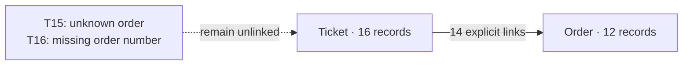

# Quickstart: ask, connect, explain

Which carrier has more delivery problems, and which orders explain the result?
Explore this question with Analytical Memory in Codex, starting with installation.
Copy each **You** message into the chat, then compare the answer with the expected
result below. Other supported assistants can follow the same conversation.

The tables below show expected results from the bundled synthetic retail data,
not a verbatim Codex transcript. Wording and layout may vary. Your assistant
should obtain the values from your memory. No embedding service is needed;
the conversation uses your assistant's normal model setup.

## 1. Install the plugin

**You**

> Install the plugin https://github.com/arch7tect/analytical-memory/

The assistant follows the repository's [plugin installation instructions](plugin-installation.md),
selects the release bundle for your host, verifies it, and installs the plugin
with its skills and included server. You do not need to choose an archive or
run terminal commands.

**Expected result**

The assistant reports the installed version. If Codex needs a fresh chat to
load the plugin, it tells you to open one and continue with the next message.
A downloaded archive alone is not a completed installation. The next step
checks that the installed plugin can actually create and query a memory.

## 2. Load the first dataset

**You**

> Use Analytical Memory. Create a separate memory for the retail demo and load
> the orders from the plugin's bundled retail example. Show a few orders and
> the memory's structure. Keep my other memories unchanged.

**Expected result**

A new named memory, normally `retail-demo`, contains 12 orders. If that name is
already in use, the assistant chooses a fresh name and reports it. Continue in
this chat so subsequent requests use that same demo memory.

| Order | Carrier | Region | Amount, cents |
| --- | --- | --- | ---: |
| O-101 | FastShip | North | 10000 |
| O-104 | FastShip | South | 10000 |
| O-110 | EcoPost | South | 10000 |

```text
Before: empty memory
After:  Order · 12 records
          order_id       string
          carrier        string
          region         string
          amount_cents   number
```

The structure is discovered from the data. You did not define a database table.
Each order costs 10000 cents; later we will count orders separately from contacts.

## 3. Add support tickets

**You**

> In this demo memory, load the support tickets from the bundled retail example.
> Show a few tickets and how the memory's structure changed.

**Expected result**

16 tickets are added alongside the 12 orders.

| Ticket | Order | Issue |
| --- | --- | --- |
| T02 | O-104 | late_delivery |
| T03 | O-104 | late_delivery |
| T15 | O-999 | late_delivery |
| T16 | — | damaged |

```text
Order · 12 records                 Ticket · 16 records
  order_id                           ticket_id
  carrier                            order_id
  region                             issue_code
  amount_cents                       message

Two entity types. No relationships yet.
```

Several contacts can concern the same order. One ticket refers to an unknown
order; another has no order number. Matching field names do not automatically
connect the datasets.

## 4. Connect them and inspect the answer

**You**

> Connect tickets to orders by order number. Show delivery-related tickets
> together with their order's carrier and region. Treat late delivery and
> damage as delivery problems. Which tickets could not be connected?

**Expected result**

14 relationships are created. T15 cannot be connected because O-999 is absent;
T16 has no order number. The connected delivery query returns 10 contacts,
including these rows:

| Order | Carrier | Region | Ticket | Issue |
| --- | --- | --- | --- | --- |
| O-104 | FastShip | South | T02 | late_delivery |
| O-104 | FastShip | South | T03 | late_delivery |
| O-110 | EcoPost | South | T08 | late_delivery |
| O-111 | EcoPost | South | T09 | damaged |



Now a ticket can be explained using information from its order. The two rows
for O-104 are separate contacts about one order, which matters for the next question.

## 5. Compare carriers fairly

**You**

> Compare carriers by the share of orders with delivery problems. Count each
> affected order once even if it has several tickets. Include all orders in the
> denominator, including those with no delivery complaints. Also show the number
> of delivery contacts and how many delivery tickets remain unattributed.

**Expected result**

| Carrier | Delivery contacts | Affected orders | All orders | Share affected |
| --- | ---: | ---: | ---: | ---: |
| EcoPost | 5 | 5 | 6 | 83.3% (5/6) |
| FastShip | 5 | 2 | 6 | 33.3% (2/6) |
| Total | 10 | 7 | 12 | 58.3% (7/12) |

Of 16 imported tickets, 12 concern delivery: 10 are attributed to orders and
2 remain unattributed. Billing-only tickets are excluded from delivery contacts.

**What the answer tells you:** equal contact counts hide different numbers of
affected orders. EcoPost has more affected orders in this small synthetic sample.
This comparison identifies an association, not a proven cause or a production verdict.
The plugin computes the aggregates over the full matching population.

## 6. Open one aggregate row

**You**

> Break the result down by carrier and region, including the value of affected
> orders. Then open the EcoPost / South row: show the exact affected orders and
> their delivery tickets. Explain how those records produce the aggregate.

**Expected result**

| Carrier | Region | Orders | Delivery contacts | Affected orders | Affected value, cents |
| --- | --- | ---: | ---: | ---: | ---: |
| EcoPost | South | 3 | 3 | 3 | 30000 |
| EcoPost | North | 3 | 2 | 2 | 20000 |
| FastShip | North | 3 | 1 | 1 | 10000 |
| FastShip | South | 3 | 4 | 1 | 10000 |

The EcoPost / South row opens into:

| Order | Amount, cents | Delivery ticket | Issue |
| --- | ---: | --- | --- |
| O-110 | 10000 | T08 | late_delivery |
| O-111 | 10000 | T09 | damaged |
| O-112 | 10000 | T10 | late_delivery |

Three distinct orders contribute 30000 cents. FastShip / South has four
contacts about a single order, so its affected value is only 10000 cents.
Affected value means the price of affected orders, not lost revenue.

```text
Aggregate row → exact contributing orders → related delivery tickets
```

## 7. Save the answer and add a new field

**You**

> Save this delivery analysis so we can revisit its original results and records.
> Then load the warehouse enrichment from the bundled retail example. Show the
> structure before and after, and the warehouses for the three EcoPost / South
> orders. Has the saved analysis become outdated?

**Expected result**

The saved analysis retains its original inputs. The enrichment updates the
12 existing orders without creating new ones or removing their relationships.

```text
Before: Order(order_id, carrier, region, amount_cents)
After:  Order(order_id, carrier, region, amount_cents, +warehouse)

Ticket ──order──> Order
Still 28 records and 14 relationships.
```

O-110, O-111 and O-112 now have warehouse W1; the other orders have W2.
The assistant can query the new field immediately. The saved analysis is marked
potentially stale because the memory has changed, even though these delivery
totals still agree with its saved values.

## 8. Correct a ticket and compare past with present

**You**

> Load the ticket correction from the bundled retail example. Recalculate the
> delivery analysis and compare it with our saved result. Open the saved and
> current EcoPost / South delivery contacts so I can see what changed. Did the
> structure change as well?

**Expected result**

T14, already connected to O-112, changes its issue code from billing to late
delivery. Its original message text stays unchanged; this analysis uses the
issue code. No new record, relationship or field is needed.

| EcoPost / South | Saved result | Current result |
| --- | ---: | ---: |
| Delivery contacts | 3 | 4 |
| Affected orders | 3 | 3 |
| Affected value, cents | 30000 | 30000 |
| Delivery ticket IDs | T08, T09, T10 | T08, T09, T10, T14 |

Across all groups, attributed delivery contacts rise from 10 to 11. Two remain
unattributed. O-112 was already affected, so adding another delivery contact
does not increase the affected-order count or value.

The saved result still explains the earlier answer with its original input
values. Its freshness warning prevents confusing that answer with the current
memory. Unlike adding `warehouse`, correcting a value leaves the structure unchanged.

## What you have built

| Step | Records | Relationships | Structure |
| --- | ---: | ---: | --- |
| Load orders | 12 | 0 | Order and its fields |
| Load tickets | 28 | 0 | +Ticket and its fields |
| Connect datasets | 28 | 14 | +Ticket → Order |
| Calculate, drill, save | 28 | 14 | Unchanged |
| Add warehouses | 28 | 14 | +Order.warehouse |
| Correct a ticket | 28 | 14 | Unchanged; answers change |

You can now replace this synthetic case with your own datasets: import them
separately, connect them explicitly, ask analytical questions, and inspect the
records behind an answer. The demo memory remains available for further questions.

See [native analytics](reference/native-analytics.md) for precise query and
saved-analysis behavior, [search](reference/semantic-retrieval.md) for text
retrieval, and [operations](reference/operations.md) for backups. If you need
PostgreSQL, the installation guide uses the included [Docker setup](reference/backend-portability.md#select-a-backend).

## Data handling and privacy

The example data is synthetic. Before loading your own sensitive data, declare
private entities or fields: data defaults to public. Local queries can read
private values; labels govern sharing and external processing.

Saved analyses retain immutable inputs for historical detail. Other current
values have no general history. Optional semantic search sends eligible public
text and query text to an external provider; it is not used in this walkthrough.
